# 🤖 PetBot

**A tiny Bangla-speaking desk pet robot** — ESP8266 + 0.96" OLED + MPU6050 + touch + buzzer + 2 servo arms.

**Designed & Developed by [Al-Mamun](https://github.com/999mamun999)** · A Personal Project • 2026

<p>
  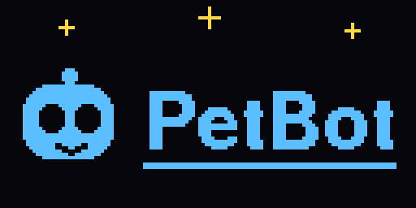 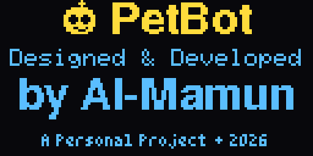 
</p>

PetBot lives on your desk: it has EMO-style eyes and moods, reacts to touch, shaking and tilting,
waves its little arms, sings songs (with karaoke lyrics), talks in **Bangla** (or English), shows the
Bangla calendar and prayer times, plays games and little animations, needs to be fed like a real pet,
rings alarms, and you can control it from your phone — at home through its own web page, or
**from anywhere through Telegram**.

<p>
  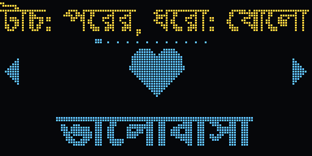 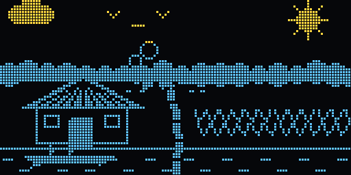 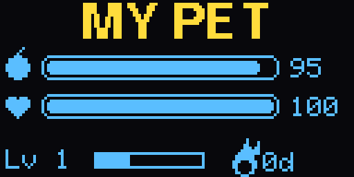
</p>

---

## ✨ Features

| | |
|---|---|
| 😊 **Moods** | 28 animated faces (happy, love, angry, sleepy, dizzy, whistle …), weather moods, "nobody plays with me" idle story, sleeps after 4 min (only a real lift or touch wakes it) |
| 👋 **Touch & motion** | taps, long press, shake → dizzy, tilt → eyes follow, rocking → love |
| 🎵 **Songs** | 14 songs incl. *Amar Sonar Bangla* (with flag screen), Bangla rhymes, karaoke lyrics |
| ⏰ **Clock mode** | big clock, date, **Bangla date (বঙ্গাব্দ)**, Hijri date, **prayer times**, weather, **tomorrow's forecast**, room temperature, timer, pet, **countdowns**, 12/24 h |
| 🕌 **Prayer & Ramadan** | computed on the robot (Karachi method, Hanafi Asr), prayer alerts, Sehri wake-up & Iftar alerts |
| 🎉 **Special days** | 21 Feb (Shaheed Minar), 26 Mar & 16 Dec (flag), Pohela Boishakh, Eid, Ramadan, your birthday 🎂 |
| 📋 **Menu (2 taps)** | everything in one place: love, songs, funny sounds, clock, games, animations, pet, About & QR, battery, language, settings (sound, night mode, 12/24 h). Tap = next, hold = open; every item comes back to the menu |
| 🎮 **8 games** | Magic 8-Ball, Ludo dice, Rock-Paper-Scissors, Reaction test, Catch the stars (tilt), Fly the bird, Memory (tilt), Ball in hole (tilt) — records are saved |
| 🎬 **11 animations** | hand-drawn pixel art with dithered shading: fireworks over a city, sunset beach, Bangladeshi village (thatched hut, kitchen smoke, paddy, *chhoi* boat), rainy night with lightning, starry sky, aquarium, steam train, space rocket, bunny pulling a carrot, a boy fishing at the pond, a *doyel* bird singing on a tree |
| 🎾 **PetBot plays sports** | press *Khelo* (phone) or `/khelo`: a mini PetBot plays football (GOAL!), a hurdle race (🏆 1st!), basketball (+2!), cricket (SIX!) or flies a kite (*BHO-KATTA!*) |
| 🐣 **Pet care** | hunger and happiness bars, feed it (phone, Telegram or hold on the *MY PET* screen) and it eats an apple, levels with fireworks, daily streak, "I'm hungry!" alerts |
| ❓ **Yes / No from Telegram** | `/q Coming to eat?` — someone at home taps the robot for **YES** or holds it for **NO**, and the answer comes back to your Telegram |
| 🌙 **Night mode** | at night (default 11 pm – 7 am): dim screen, quiet (alarms still ring), sleeps quickly, wakes up with a stretch |
| 🙃 **Gestures** | upside down for 3 s = do-not-disturb (screen off), pick it up = "Hi!" wave, knock twice on the table = clock for 5 s |
| 🔐 **Login page** | optional username + password for the phone page (only a salted hash is saved), remember me for 30 days |
| ⏰ **Alarms & reminders** | 4 alarms (any time, daily or once), bedtime reminder, reminders |
| 🎂 **Family & friends' birthdays** | up to 8 (Ammu, Abbu, Bhaiya, Apu, Nanu, Dadu, friends …): cake + song + their name on the day, age, Telegram reminder the evening before |
| ⏳ **Countdowns** | up to 4 (exam, Eid, trip …): "85 days left" on the clock, a wish on the day |
| 🌧️ **Tomorrow's weather** | max / min, rain chance; Telegram "take an umbrella ☔" in the evening when rain is likely |
| 💾 **Backup** | download all settings as one file from the phone page, restore it any time |
| 📱 **Phone page** | `http://petbot.local` — Normal / Game / Clock modes, messages, faces, songs, alarms, settings |
| ✈️ **Telegram bot** | control and get alerts from anywhere (`/love`, `/song`, `/namaz`, `/alarm 7:00`, `/remind 30m Drink water`, `/q Coming?`, `/feed`, `/pet`, `/khelo cricket`, `/scene beach`, `/bday add Rina 15-03`, `/cd add Exam 15-02-2027`, `/night 11pm-7am` …) |
| 🔋 **Battery** | LiPo percentage (8 taps), low-battery warning |
| 📡 **WiFi upload (OTA)** | update the firmware without a cable (password protected) |
| 📶 **Start-up** | "Connecting…" WiFi animation, then "WiFi connected!" with a ✓ |
| ✏️ **Clear pixel fonts** | small English text uses 3 pixel-perfect fonts made for the OLED (tiny / small / bold) |
| 👆 **Shortcut guide** | the phone page lists every touch, hold and gesture shortcut of the robot |

<p>
  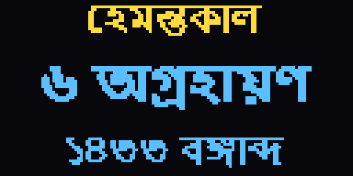  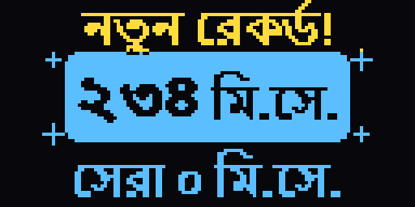
</p>
<p>
   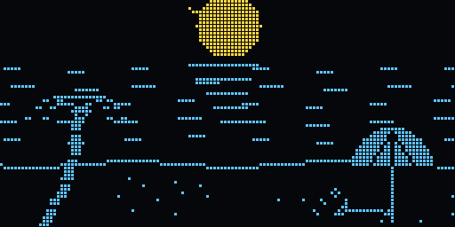 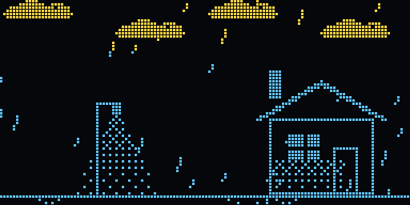
  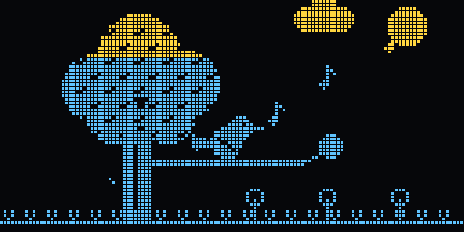 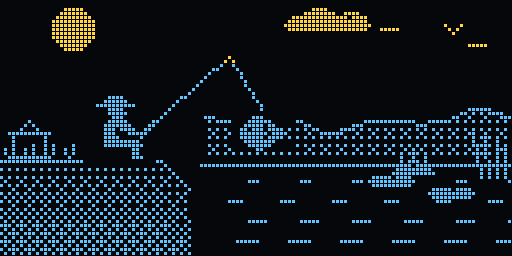 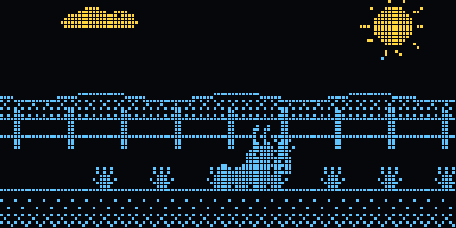
   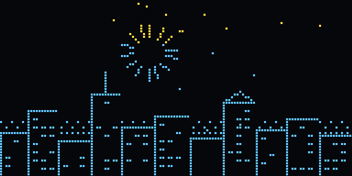 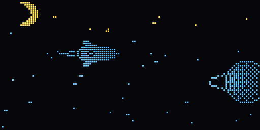
</p>
<p>
  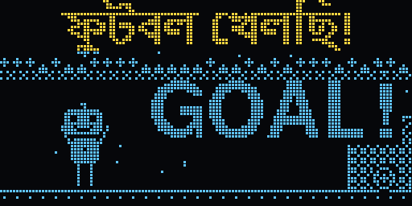 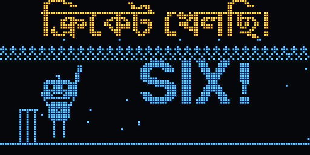 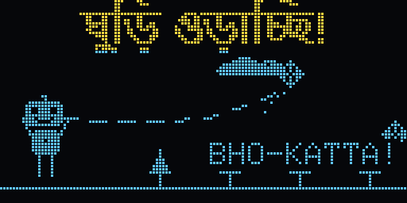
  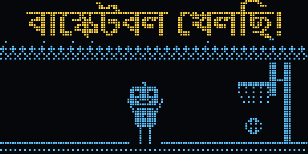 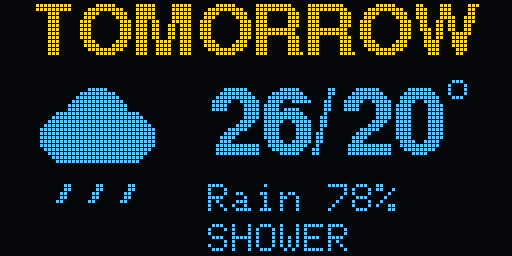 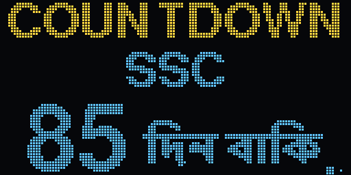
</p>
<p>
  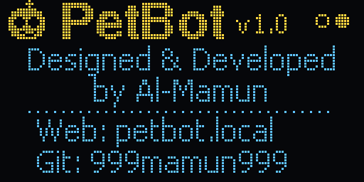 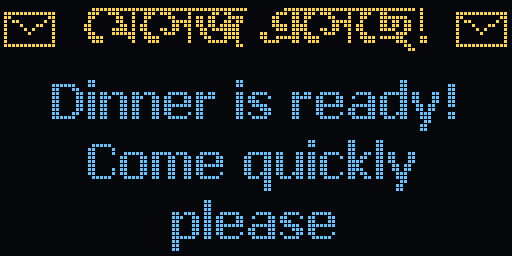 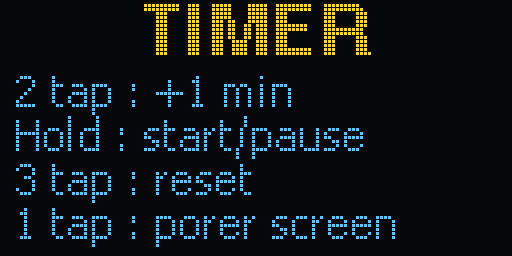
</p>
<p>
  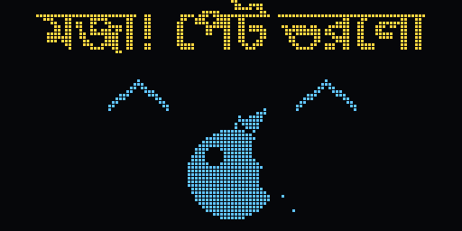 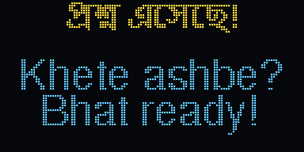 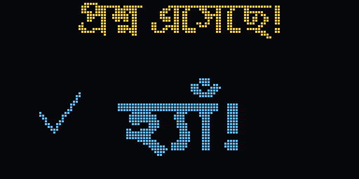
  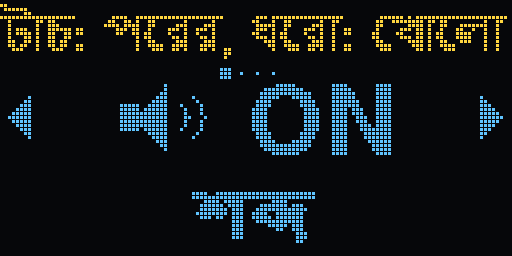 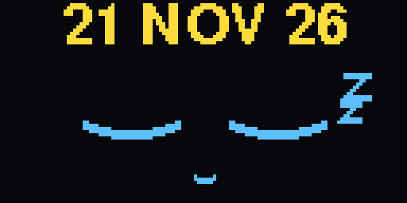
</p>

---

## 🧰 Hardware

| Part | Notes |
|---|---|
| NodeMCU ESP8266 (ESP-12E) | the brain |
| 0.96" SSD1306 OLED, I2C, 2-color (yellow 16 px + blue) | 128×64 |
| MPU6050 | motion sensor |
| TTP223 touch sensor | |
| 2-pin (passive) buzzer | |
| 2 × SG90 servo | the arms |
| 3.7 V LiPo + charger + 5 V boost module | optional battery |
| 150 kΩ resistor | optional, for battery % |

### Wiring

| From | To NodeMCU |
|---|---|
| OLED **and** MPU6050: VCC / GND / SDA / SCL | 3.3V / GND / **D2** / **D1** |
| Touch TTP223: VCC / GND / SIG | 3.3V / GND / **D5** |
| Buzzer: + / − | **D6** / GND |
| Left servo signal (yellow) | **D7** |
| Right servo signal (yellow) | **D8** |
| Servo power (red / brown) | **VU (5V)** / GND |
| *(battery %)* LiPo **B+** → **150 kΩ** → | **A0** (never connect 5V to A0) |

---

## 🚀 Setup

1. **Arduino IDE 2** → *Boards Manager* URL:
   `http://arduino.esp8266.com/stable/package_esp8266com_index.json` → install **esp8266** (3.1.2).
2. Install libraries (*Library Manager*):
   **Adafruit SSD1306**, **Adafruit GFX Library**, **WiFiManager** (tzapu), **ArduinoJson** (v7).
3. Open `PetBot/PetBot.ino`. Board: **NodeMCU 1.0 (ESP-12E Module)**, CPU **160 MHz**.
4. Edit **`PetBot/config.h`** — your name, city (latitude/longitude), time zone.
5. Upload with USB. (Or on Windows: `powershell -ExecutionPolicy Bypass -File tools\upload.ps1`)
6. **WiFi:** on your phone connect to the **`PetBot-Setup`** hotspot → choose your WiFi → save.
7. Open **`http://petbot.local`** (or the IP shown on the robot) on your phone. 🎉

### ✈️ Telegram (optional, control from anywhere)
1. In Telegram, talk to **@BotFather** → `/newbot` → copy the token.
2. On the phone page: **Settings → Telegram** → paste the token → Save.
3. Send **/start** to your bot within 10 minutes — it becomes yours (only you can control it).

### 📡 WiFi upload / OTA (optional)
```powershell
powershell -ExecutionPolicy Bypass -File tools\set_ota_password.ps1
```
This creates your own random password (`tools/ota_password.txt`) and `PetBot/secrets.h` (only its hash).
Both are in `.gitignore`. Upload once by USB; after that `tools\upload.ps1` uploads over WiFi.
Without `secrets.h`, WiFi upload is simply off.

### 🔐 Phone page login (optional)
Phone page → **Settings → Login** → username + password → Save (or Telegram: `/webpass name password`).
The page then shows a sign-in screen; "remember me" keeps you signed in for 30 days.
Forgot it? Telegram `/webpass off`, or send `L` on the USB serial monitor.
For `tools/webshot.ps1`, put `username:password` in `tools/web_login.txt` (git-ignored).

### 🔋 Battery (optional)
Connect LiPo **B+ → 150 kΩ → A0**, then 8 taps shows the battery. Calibrate from Telegram:
`/battery cal 3.95` (your multimeter reading) or `/battery full` when fully charged.

---

## 👆 Touch controls

| Taps | Action |
|---|---|
| 1 | happy |
| 2 | **menu** (tap = next, hold = open). In the clock: next screen |
| 3 | next song |
| 4 | funny sound |
| 5 | clock mode on/off (tap = next screen, hold 3 s on home = 12/24 h) |
| 6 | games (tap = next game, hold = play) |
| 7 | About + GitHub QR |
| 8 | battery |
| hold 10 s | Bangla ⇄ English |

Opened something from the menu? 2 taps (or the *Back* screen at the end of the clock) bring you back to
the menu. While a song from the menu plays: 1 tap = next song. In animations: tap = next scene, hold = back.

---

## 🛠️ Customizing

* **Your settings:** `PetBot/config.h` (name, city — the default city is just an example, set your own)
* **Bangla texts / your name in Bangla:** edit `tools/bangla_text.json` (e.g. `BN_NAME`), then run
  `tools/make_bangla.ps1` (Windows, uses the *Nirmala UI* font) → regenerates `PetBot/bangla_text.h`
* **Phone page:** edit `PetBot/web_page.h`, then run `tools/make_web.ps1` (or just `tools/upload.ps1`)
* **English fonts:** `tools/make_font.ps1` (Windows) turns a Windows font into 1-bit OLED fonts →
  `PetBot/pb_fonts.h`; compare fonts first with `tools/font_preview.ps1`
* **QR check:** `python tools/qr_decode.py shot.hex` decodes the QR straight from a robot screenshot
  (`/api/shot` after 7 taps) and prints the link
* **Pixel-art characters:** draw them in `tools/sprites.txt` (`#` white, `o` black, `.` transparent), then run
  `python tools/make_sprites.py` → regenerates `PetBot/sprites.h` + a preview in `tools/preview/sprites.png`
* **Screenshots of the OLED:** `tools/shot.ps1` (USB) or `tools/webshot.ps1` (WiFi)

---

## 🔒 Security

* No passwords, tokens or keys are in this repository.
* WiFi password → saved on the robot from the setup hotspot.
* Telegram token → pasted on the phone page, saved on the robot; the bot answers only its paired owner.
* OTA → only the MD5 hash of **your own** password, in the git-ignored `secrets.h`.

---

## 📜 License & credits

PetBot is **GPL-3.0** licensed (see `LICENSE`) **with additional terms** (see [`NOTICE`](NOTICE)):

> The original author credits — the start-up credit screen, the **GitHub QR code / About card (7 taps)**
> and the web page credit line — **must be kept unchanged** in every copy and modified version.
> You may add *your* name ("Modified by …"), but not remove or replace the original credits.

The firmware checks the credits at start-up; if they were changed, the robot shows the original author's credit.

Made with ❤️ in Bangladesh by **[Al-Mamun](https://github.com/999mamun999)**.

---

### বাংলায় সংক্ষেপে
PetBot একটি ছোট্ট বাংলা-বলা ডেস্ক রোবট। `PetBot/config.h`-এ নিজের নাম, শহর আর সময় অঞ্চল বসিয়ে আপলোড করুন।
ফোন থেকে `http://petbot.local`, আর যেকোনো জায়গা থেকে Telegram দিয়ে চালানো যায়।
ফোনের পেজে রোবটের সব শর্টকাট লেখা আছে ("👆 Robot er shortcut")।
২ বার টাচ করলে মেনু: গান, খেলা, ১১টা অ্যানিমেশন (গ্রাম, সমুদ্র, খরগোশ, পুকুরে মাছ ধরা...), পোষা রোবটের যত্ন, রাতের মোড আর সেটিং।
ফোনে "খেলো" চাপলে PetBot নিজে ফুটবল, ক্রিকেট, বাস্কেটবল খেলে বা ঘুড়ি ওড়ায়। বন্ধুদের জন্মদিন, কাউন্টডাউন, কালকের আবহাওয়া আর সেটিং ব্যাকআপও আছে।
**শুরুর ক্রেডিট স্ক্রিন ও GitHub QR পরিবর্তন করা যাবে না** (লাইসেন্সের শর্ত)।
